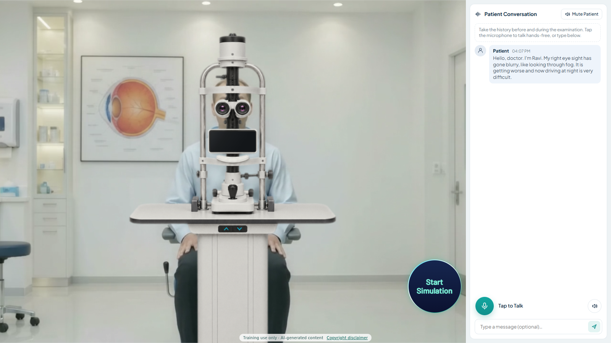
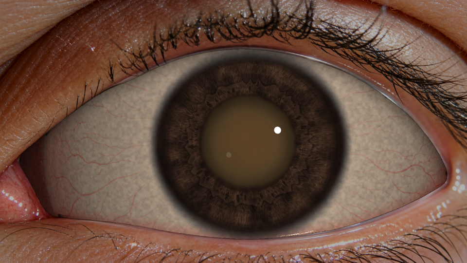
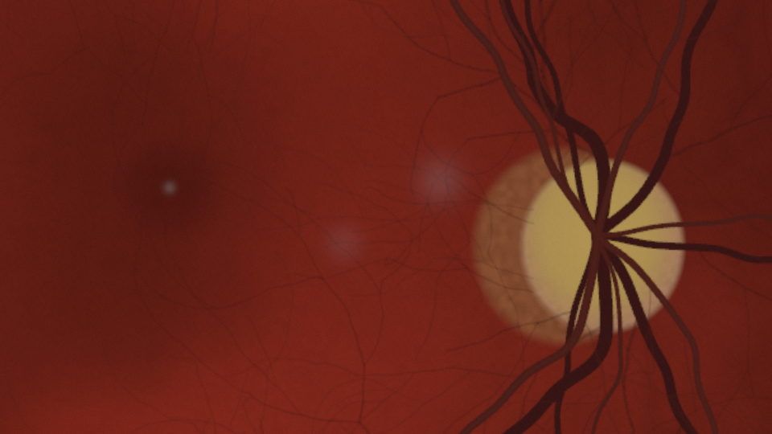
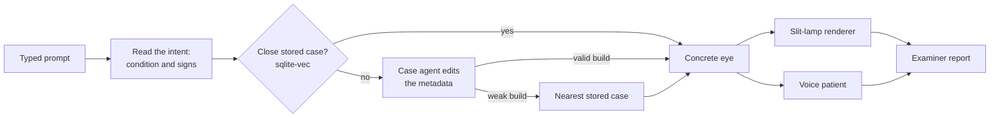
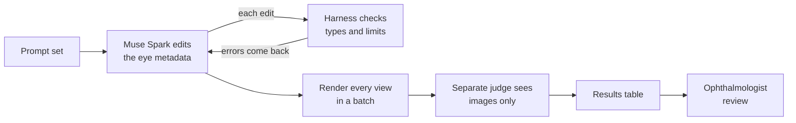

<p align="center">
  
</p>

<p align="center"><strong>Describe a disease. Examine the eye. Get scored.</strong><br>
A browser-based slit-lamp simulator for trainee ophthalmologists.</p>

<p align="center"><a href="https://eyesim.onrender.com/"><strong>Try the live site</strong></a></p>

<p align="center">
  
</p>
<p align="center">
  
  
</p>
<p align="center"><sub>Top: the patient screen, where the history starts. Left: an advanced nuclear cataract. Right: the fundus in advanced glaucoma, seen through a 90D lens, so the image is inverted. Both eyes are rendered, not photographed.</sub></p>

> **Training prototype, not a medical device.** It must not be used to diagnose or treat real patients. An ophthalmologist has validated the cataract and conjunctivitis cases and some of the glaucoma cases. Other cases have not had that review. See [Limitations](#limitations).

VibeDoc is the product name. The code and metadata still use its working name, **EyeSim**.

## What a session looks like

1. **Choose a case.** Type a description, such as "62-year-old woman with sudden pain and haloes in the right eye", or ask to be assigned a patient.
2. **Meet the patient.** A patient chosen to fit the case's age and sex walks in and sits at the lamp.
3. **Take a history by voice or text.** The patient answers in speech, knows only what a patient would know, and moves their eyes when asked.
4. **Examine the eye.** Control the slit width, height, angle, magnification, focus and filters. Findings appear according to how the light is used.
5. **Write the case sheet.** Record findings for each structure in each eye, a diagnosis, differentials and a plan.
6. **Read the report.** An examiner scores the sheet, the history and the lamp log against an answer key the trainee never sees.

## How it works

The eye is **data, not painting**. A healthy eye is 28 JSON components, each holding physical properties with a unit, a normal range and a hard limit. Diseases change those properties (scatter, absorption, thickness, position), and a ray-marching shader renders the result, so a finding behaves correctly under every illumination instead of being a texture that only looks right from one angle.



| Part | What it does | Where |
|---|---|---|
| **Eye model** | Components, diseases, variants, cases and anatomy rules, all checked against JSON Schemas | [`eye-model/`](eye-model/) |
| **Resolver** | Turns a case into a concrete eye: variants, diseases, exam conditions, overrides, age functions, derived values, range checks | [`src/model/resolve.ts`](src/model/resolve.ts) |
| **Renderer** | One module per component type, feeding a ray-marching fragment shader through Three.js | [`src/render/`](src/render/) |
| **Case matching** | Finds the closest stored case. The condition's name must fit first, then the signs must be close, so a prompt is never forced onto the nearest case | [`server/case-match.ts`](server/case-match.ts) |
| **Case agent** | When nothing matches, builds the eye through a tool harness that rejects invalid edits | [`server/case-agent.ts`](server/case-agent.ts), [`server/harness.ts`](server/harness.ts) |
| **Voice patient** | Streams replies from a fixed fact sheet. Has one tool, `move_eyes`, and no access to the eye model. Each sentence is checked before it leaves the server, so the diagnosis never reaches the trainee | [`server/patient.ts`](server/patient.ts) |
| **Examiner** | The model judges each dimension against one rubric. The server does the arithmetic, applies the safety rules and drops any quote the trainee never wrote | [`server/examiner.ts`](server/examiner.ts), [`server/rubric.json`](server/rubric.json) |

### Scoring

Stored cases reward finding the diagnosis. In a prompt case the trainee already knows it, so history and observation carry the score.

| Dimension | Stored case | Prompt case |
|---|---:|---:|
| Diagnosis | 30% | 10% |
| Observations | 25% | 30% |
| History | 20% | 30% |
| Lamp technique | 15% | 20% |
| Safety | 10% | 10% |

### Models and services

All language, vision and speech-to-text calls go through [`server/gateway.ts`](server/gateway.ts) to the Meta Model API. API keys stay on the server and never reach the browser.

| Job | Service |
|---|---|
| Case agent, patient, examiner | Meta `muse-spark-1.3` |
| Speech to text | Meta `muse-voice-transcribe-1.0`, plus a live WebSocket stream |
| Patient's voice | ElevenLabs, or the browser's own voice if no key is set |
| Internal testing only: render judge | Meta `muse-spark-1.3` |
| Internal testing only: comparison illustrations | Meta `muse-image-1.0` |

## How we built and tested it quickly

The hard part was not writing the renderer. It was getting the eye metadata to look right. Each property, such as how much the lens scatters light, has to produce a believable result in every illumination, and rendering and checking one prompt at a time took far too long. Two things sped this up.

This tooling is for our internal testing and isn't part of the live site.

**Rendering everything at once.** `npm run review` takes a whole prompt set, 40 prompts per disease, and runs it unattended. All the builds and judgements run in parallel, while the renders share a queue through headless Chrome. Software rendering keeps the results independent of the GPU, and everything ends up in one table with the prompt, the views and the readings side by side. A problem that only shows in some cases becomes visible at a glance, and an ophthalmologist can review a whole scenario set in one sitting.

**An agent loop on Muse Spark.** Spark changes the eye only through tools, never by writing shader code or painting pixels:



1. **Build and self-correct.** Spark reads the available properties, makes edits and validates the eye. The harness returns errors as data, so Spark can correct itself, and it can't finish an invalid eye without being sent back to fix it. Builds that change almost nothing are flagged as weak.
2. **Judge blind.** A second Spark call sees only the rendered images, never the prompt or the values. It reports the likely diagnosis, severity and the most unrealistic detail, and its answer is then scored against the intended diagnosis outside the model.
3. **Review all at once, then fix.** We review the whole set together. If anything needs fixing, Spark makes the fixes across the set in one go.

Two checks keep each round from breaking earlier work. `npm run validate` rejects metadata that breaks the schemas or anatomy rules, and `npm run test:visual` compares renders with reference images. A clip of the loop running is at [`docs/evaluation/tooling-loop.mp4`](docs/evaluation/tooling-loop.mp4).

## Getting started

The quickest way to try it is the [live site](https://eyesim.onrender.com/). To run it yourself, you need **Node.js 22 or newer** (the repo pins 24 in [`.node-version`](.node-version)) and a Meta Model API key. An ElevenLabs key is optional. Google Chrome is needed only for the render, visual-test and review tools.

```bash
git clone https://github.com/code4srikanth/Vibe-Doc.git
cd Vibe-Doc
npm ci
cp .env.example .env     # then add META_API_KEY, and ELEVEN_LABS if you have one
```

Run the API server and the Vite dev server in two terminals:

```bash
npm run server           # API on http://localhost:8787
npm run dev              # app on the URL Vite prints, proxying /api to the server
```

To run it as production does, from one process:

```bash
npm run build
npm start
```

### Configuration

| Variable | Needed | Purpose |
|---|---|---|
| `META_API_KEY` | Yes | Case agent, patient, examiner and transcription |
| `ELEVEN_LABS` | No | Patient's voice |
| `PORT` | No | Server port, default 8787 |
| `TRUST_PROXY_HOPS` | When hosted | Proxies in front of the server: 1 on Render, 2 with Cloudflare in front |

Model overrides and per-visitor limits are listed in [`.env.example`](.env.example). Never name a secret `VITE_*`, because Vite ships those to every browser.

## Commands

| Command | What it does |
|---|---|
| `npm run validate` | Regenerates the manifest, then checks schemas, types, references, disease patches, grade monotonicity, anatomy rules and renderer coverage |
| `npm run typecheck` | Type-checks the project |
| `npm run test:server` | Runs the server tests, using scripted models so no API key is needed |
| `npm run test:visual` | Compares renders with the reference images (`-- --update` after an intended change) |
| `npm run render -- --out .tmp/check --cases aacg --views diffuse` | Renders chosen cases and views to files |
| `npm run agent -- "your prompt"` | Runs the case agent once from the terminal |
| `npm run patient -- aacg` | Talks to a stored case's patient from the terminal |
| `npm run review -- --file docs/evaluation/glaucoma.prompts.json` | Internal testing: builds, renders and judges a whole prompt set |
| `npm run gen:types` | Regenerates `src/model/generated.ts` after a schema change |

## Evaluation

Our internal testing puts a whole scenario set on one page. Each row shows the prompt, the renders and two readings. Judge 1 sees only the images; Judge 2 was written with the prompt in view.

| Scenario set | Prompts | Judge 1 named the right diagnosis | Builds flagged weak |
|---|---:|---:|---:|
| [Cataract](docs/evaluation/cataract.md) | 40 | 10 | 26 |
| [Conjunctivitis](docs/evaluation/conjunctivitis.md) | 40 | 9 | 6 |
| [Glaucoma](docs/evaluation/glaucoma.md) | 40 | 3 | 2 |

These counts measure what an AI judge recognises from images alone across eyes the agent built, not the ophthalmologist's validation of the stored cases. Many prompts go well beyond the stored scenarios, into rarities such as neonatal or genetic disease. The tables also record what is wrong with each render, and Judge 1 never scored realism above 3 out of 5.

## Limitations

- **Clinical validation is partial.** An ophthalmologist has validated the cataract and conjunctivitis cases and some of the glaucoma cases. The remaining glaucoma cases, eyes the agent builds from a prompt, the match threshold and the scoring rubric have not had that review. Values marked `provenance.confidence: "low"` are calibrated to look right in the renderer.
- **Limited disease coverage.** There are metadata definitions for nuclear and cortical cataract, primary open-angle and acute angle-closure glaucoma, bacterial conjunctivitis and arcus senilis. Other conditions depend on what the case agent can express, and often come out weak or wrong.
- **One affected eye.** The disease is placed in one eye and the other is a mirrored healthy eye, so bilateral prompts are not fully represented.
- **Patient appearance often misses the prompt.** Skin tone, iris colour and childhood anatomy frequently do not come through in agent-built eyes.
- **Sessions live in memory.** Run a single server instance, and expect open sessions to end on a restart.

## Deploying

The app and API run as one Node web service, so hosting needs only one service. [`render.yaml`](render.yaml) describes it for Render:

- **Build:** `npm ci --include=dev && npm run build`
- **Start:** `npm start`
- **Health check:** `/api/health`

Set `META_API_KEY` and, if used, `ELEVEN_LABS` in the host's environment settings, never in the repo. The live microphone needs WebSocket support on the same service.

## Project layout

```text
eye-model/    The eye as metadata: normal/, diseases/, variants/, cases/, rules/, schema/
src/model/    Resolver, edits and generated types
src/render/   Render modules and the ray-marching shader
src/exam/     Slit-lamp settings per view, and the exterior view
src/ui/       Landing, lobby, prompt, exam, case sheet and report screens
server/       API, case agent, matching, patient, voice, examiner, judge and limits
tools/        Manifest, validator, renderer, visual tests and internal review tooling
tests/        Reference images for the visual tests
docs/         Evaluation tables, prompt sets and README images
assets/       Brand, lobby, exterior and scene images
videos/       Patient walk-in clips
```

[`AGENTS.md`](AGENTS.md) holds the working rules for changing the eye model. The main ones: every number is a quantity with a unit and limits, no value is stored twice, and no clinical numbers go in `src/`.

## Credits and licence

All images and animations are AI-generated, mostly with Meta's AI tools. They do not depict real people, and the eye findings are simulated from this project's data, not taken from clinical photographs or patient records.

Built for the Meta developer hackathon. No licence has been chosen yet, so default copyright applies and the code is not licensed for reuse.
